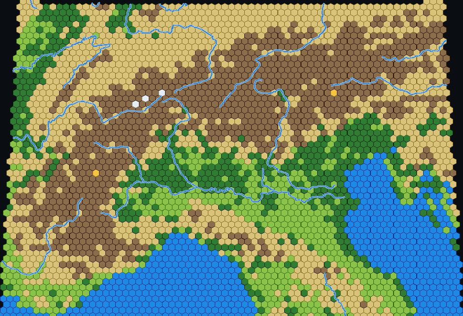

# Hex Earth

Turn real satellite imagery and elevation data into a hex map.

Given a latitude/longitude box, Hex Earth projects the region onto a tangent plane, lays a
uniform hex grid, samples NASA Blue Marble colour and Terrarium elevation per hex, classifies
each hex as one of seven terrain types, and overlays Natural Earth rivers.



## Status

Two implementations exist. **[hexearth-worker](hexearth-worker/)** is the active one;
**[hexmap](hexmap/)** is the original server-side implementation, kept as a reference and as
a batch/offline tool.

| | `hexearth-worker/` (active) | `hexmap/` (reference) |
|---|---|---|
| Where compute runs | Browser (Web Workers not needed) | Python server |
| Deployment | Cloudflare Workers + static assets | `python app.py` on port 8080 |
| Hosting cost | ≈0 (proxy traffic only) | CPU per request |
| Rivers | Natural Earth 50m, client-side clipping | Natural Earth 10m, Shapely clipping |
| Tests | `npm test` | none |

The findings that produced this split are in [REVIEW.md](REVIEW.md) (classification accuracy,
proxy caching, geometry edge cases). It is the reference for the roadmap.

## Quick start — Worker (active)

```bash
cd hexearth-worker
npm install
npm run dev        # http://localhost:8787
```

The Worker serves `public/` as static assets and exposes three proxy routes so the browser can
read imagery cross-origin with untainted canvases:

| Route | Upstream |
|---|---|
| `/proxy/world` | NASA GIBS Blue Marble, whole world, 2048×1024 |
| `/proxy/satellite?latmin&latmax&lonmin&lonmax&w&h` | NASA GIBS Blue Marble for a bbox |
| `/proxy/dem?z&x&y` | AWS Open Data Terrarium elevation tile |

Deploy with `npm run deploy` (requires `wrangler login`).

Checks:

```bash
npm test           # node --test, no dependencies required
npm run check      # tsc --noEmit
```

## Quick start — Flask (reference)

```bash
pip install -r requirements.txt
cd hexmap
python app.py      # http://localhost:8080
```

Routes: `/`, `/api/worldmap`, `/api/types`, `/api/health`,
`/api/generate?lat0&lat1&lon0&lon1&cols&proj&rivers`.

The app caches data on disk next to the sources (`world.jpg`, `ne_rivers.geojson`,
`dem_cache/`). Those paths are gitignored; the DEM cache is currently unbounded.

## How it works

1. **Projection** — a centred azimuthal projection chosen by the user: Lambert Azimuthal
   Equal-Area (`equalarea`, default) or Azimuthal Equidistant (`equidistant`). The projected
   extent is computed from sampled rectangle edges, not just the four corners.
2. **Lattice** — pointy-top hexagons laid in the projected plane, sized so `cols` hexes span
   the region's width. Hexes whose centre falls outside the bbox are dropped.
3. **Sampling** — one colour sample per hex centre, plus five elevation samples for the mean
   and the relief (max − min) inside the cell.
4. **Classification** — water from Natural Earth land/lake vectors; snow above the snow line;
   mountain/hill/plain from *relief* rather than absolute altitude; desert/forest/grassland
   from colour within the low-relief band.
5. **Rivers** — Natural Earth centerlines clipped to the hexagons they cross and drawn as an
   overlay on top of the underlying terrain (a river hex keeps its terrain type).

Projection and grid maths are pure functions in `hexearth-worker/public/lib.mjs`, ported 1:1
from the Python reference and unit-tested independently of the DOM.

## Data sources

- **Imagery:** [NASA GIBS](https://nasa-gibs.github.io/gibs-api-docs/) — Blue Marble Next Generation
- **Elevation:** [AWS Open Data Terrain Tiles](https://registry.opendata.aws/terrain-tiles/) — Terrarium PNG encoding
- **Rivers / land / lakes:** [Natural Earth](https://www.naturalearthdata.com/) (public domain)

Attribution is required for the imagery and elevation layers; see the credits line in the UI.

## Known limitations

- Classification agrees with hand-checked reference biomes 92% of the time (it was 57% before
  the vector masks and relief-based bands). The remaining errors are honest ones: semi-arid
  steppe is not separable from desert by point colour, and a forested mountain is labelled
  by landform. See REVIEW.md (D1–D3) and `test/fixtures/biomes.json`.
- One colour pixel per hex: coarse densities can miss small features entirely.
- The rendered canvas is capped at 940 px on its long edge.
- Regions larger than ~70° or crossing the antimeridian are rejected.
- v1 requires Shapely ≥ 2.0 (earlier versions make rivers silently disappear).

## Licence

No licence has been chosen yet — add one before accepting external contributions.
