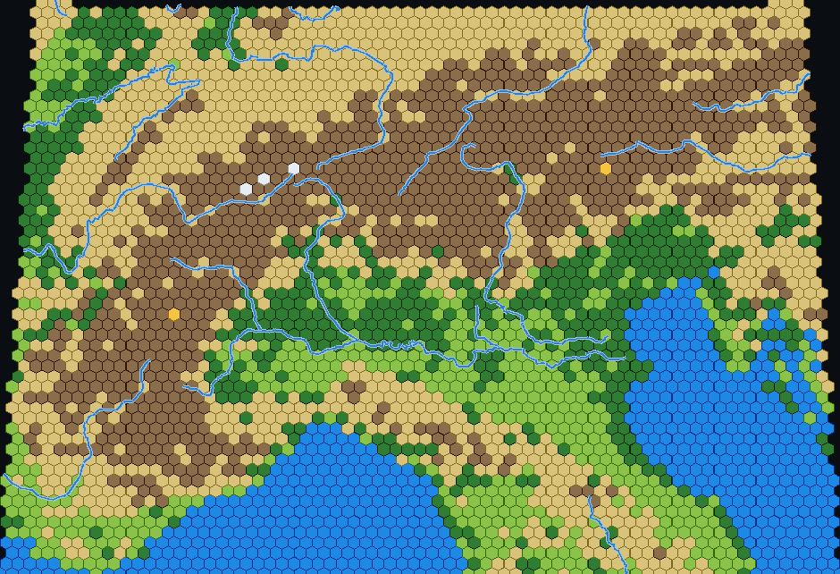
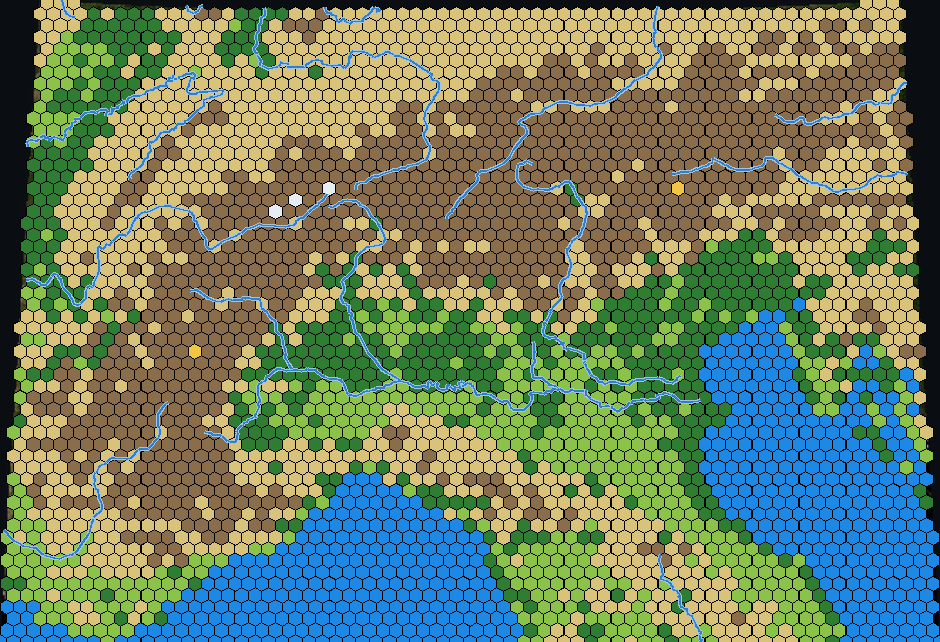

# Hex Earth — project review

**Reviewed:** 2026-11-04 · **Scope:** `/home/p/hexmapgen` (both subprojects) · **Method:** read all ~2,370 lines of source, ran both implementations, and executed targeted experiments (details in the appendix).

---

## Verdict

The **hard, interesting part of this project works**. The azimuthal projection math is exact, the hex lattice is sound, the NASA/Blue Marble + Terrarium DEM pipeline is accurate, and the Python → JavaScript port is faithful to the last bit. What you have is a working prototype with a genuinely good idea behind it.

The **unfinished parts are not the geometry — they are semantics and productisation**:

1. The map is currently a *hypsometric tint* (elevation bands colouring elevation bands), not a terrain/land-cover map. Measured agreement against 49 hand-labelled reference biomes: **57%**, with grassland at **17%** and forest at **38%** recall.
2. There are **two complete implementations** that have already started to drift, and nothing (no git, no tests, no CI, no README, no dependency manifest) to keep them honest.
3. The **v2 (Cloudflare Worker) path is the right architecture but is unshipped**: no caching (every request re-hits NASA/S3), no input validation, no shareable output, no error surfaces.

**Recommendation:** commit to the Worker architecture, freeze the Flask app as a reference implementation and local batch tool, then spend the next milestone on *classification quality* rather than more features. The single highest-leverage change is replacing colour-hue guessing with **vector land/sea/lake masks + relief-relative terrain bands**. That one change would take the map from "plausible" to "actually right".

| | |
|---|---|
| Concept | Strong — real Earth data → playable/printable hex map |
| Engine (projection, lattice, DEM, ports) | Solid, verified |
| Classification | Weak — 57% vs reference biomes |
| Engineering hygiene | Absent — no VCS, tests, docs, manifests |
| Product readiness | Prototype — no persistence, export, permalinks |
| Deployment | Worker builds and serves; Flask is a dev server only |

---

## 1. What exists

Two generations of the same product, living side by side, with no marker saying which is canonical.

| Path | Role | Stack | LOC |
|---|---|---|---|
| `hexmap/` | **v1** — server-side renderer | Flask + NumPy + Pillow + Shapely | 615 Python + 468 HTML/JS |
| `hexearth-worker/` | **v2** — client-side renderer behind a Worker | Workers + vanilla ES modules | 797 total (`app.js` 470, `lib.mjs` 135, `index.html` 154, `index.ts` 38) |

**v1 pipeline (server):** region → tangent-plane projection (`geo.py`) → pointy-top lattice → Blue Marble sample + Terrarium DEM mosaic (`imagery.py`, `terrain.py`) → 7-type classify (`terrain.py`) → Natural Earth 10m rivers clipped to hexagons with Shapely (`rivers.py`) → JSON with a base64 satellite backdrop.

**v2 pipeline (browser):** identical maths ported 1:1 into `lib.mjs`; `app.js` fetches the same two upstreams through three Worker proxy routes, builds the lattice, classifies, clips rivers with a hand-written Cyrus–Beck clipper, and renders. The Worker is deliberately dumb: static host + proxy (`src/index.ts`, 38 lines).

The v2 front-end is a genuine UX improvement: two screens (full-bleed zoomable region picker → map), scroll-zoom, quick-region dropdown, PNG export, live density/projection controls.

### What is finished vs. stubbed

- ✅ Both pipelines produce correct, good-looking output end-to-end (see [alps-classification.png](review-assets/alps-classification.png)).
- ✅ The port is exact: **0 mismatches in 3,000 randomised classifier samples** between Python and JS; projection round-trip error **4.4 × 10⁻¹¹ °**.
- ✅ Worker config builds cleanly (`wrangler deploy --dry-run`, wrangler 4.149).
- ⚠️ v1 runs only after manually installing Flask 3 + Shapely 2 (nothing declares them).
- ⚠️ v2 is not deployed and has never had its pipeline exercised on real data outside a browser.
- ❌ No git repository, no README, no tests, no CI, no licence, no `.gitignore`.

---

## 2. Verified working behaviour

Measurements taken on this machine (network access to GIBS and S3 confirmed):

| Check | Result |
|---|---|
| `/api/health`, `/`, `/api/worldmap` | 200; world map 209 KB |
| `/api/generate` Alps preset, 70 cols, 3,698 hexes, 940×642 canvas | **6.2 s cold / 3.4 s warm** |
| Error paths (missing params, >70° span) | Correct 400 + JSON message |
| Worker `/`, `/app.js`, `/lib.mjs`, `/rivers.geojson` | 200, correct MIME (`application/geo+json` for rivers) |
| Worker `/proxy/world`, `/proxy/dem` | 200, correct content types |
| DEM accuracy vs known heights | Mont Blanc **4,675 m** (real 4,808), L. Victoria **1,134 m** (1,134), Titicaca **3,815 m** (3,812), Caspian **−29 m** (−28) |
| Output stability across density (25/70/160 cols) | Type shares within **±2.6 pp** |



*Same region with the satellite backdrop at 50% (as the app draws it):*



The imagery is correct and north-up; the DEM is excellent. The output *looks* like a real hex map. The problems are in what the colours mean.

---

## 3. Defects and risks

Severity: **P0** = blocks a credible release · **P1** = serious quality/robustness issue · **P2** = polish/tech debt.

| # | Sev | Area | Issue |
|---|---|---|---|
| D1 | P0 | Classifier | Elevation bands dominate; 57% agreement with reference biomes |
| D2 | P0 | Classifier | Water detection fails on Blue Marble's near-black oceans/lakes |
| D3 | P1 | Classifier | Absolute elevation thresholds are meaningless across latitudes |
| D4 | P1 | Ops | No VCS, tests, docs, dependency manifests — nothing reproducible |
| D5 | P1 | Worker | Proxy passes `no-store` upstream → **zero caching**, every tile hits origin |
| D6 | P1 | Worker | Proxy returns 200 + GIBS error image on bad/missing params; no validation |
| D7 | P1 | Migration | Two full implementations, constants duplicated 2–3×, already diverging |
| D8 | P2 | Geometry | Projected bbox from 4 corners only → 1.5–4.9% vertical crop |
| D9 | P2 | Sampling | One pixel per hex at its centre; no per-cell aggregation |
| D10 | P2 | Caching | 97 MB unbounded server DEM cache; none client-side |
| D11 | P2 | Output | 940 px canvas cap; no SVG/GeoJSON/hi-res export, no permalinks |
| D12 | P2 | Robustness | No timeouts/aborts; rivers & backdrop fail silently; antimeridian unsupported |
| D13 | P3 | Code | Path-string hack, dead code, unused imports, unused TS types dep |
| D14 | P3 | A11y/UX | No keyboard access, no aria, no pinch-zoom, canvas-only output |

### D1 — The classifier describes elevation, not terrain (P0)

Reference benchmark: 49 unambiguous points (open ocean, great lakes, rainforests, deserts, steppes, mountain ranges, ice sheets), sampled through the project's own modules.

| expected ↓ / got → | water | forest | desert | grass | mountain | snow | recall |
|---|---|---|---|---|---|---|---|
| water | **16** | 1 | 0 | 1 | 2 | 0 | 80% |
| forest | 0 | **3** | 0 | 0 | 1 | 0 | 38% |
| desert | 0 | 0 | **3** | 1 | 2 | 0 | 43% |
| grass | 0 | 2 | 0 | **1** | 1 | 0 | 17% |
| mountain | 1 | 0 | 0 | 0 | **2** | 2 | 40% |
| snow | 0 | 0 | 0 | 0 | 0 | **3** | 100% |

**Overall 28/49 = 57%.**

The failure mode is systematic, not random. In `classify()` the colour test only splits water / desert / green / bare; everything else is decided by altitude against fixed thresholds (350 m, 1,000 m, 4,200 m). So:

- Congo rainforest at 422 m → **Hill**. Borneo (367 m) → **Hill**. Boreal Sweden (400 m) → **Hill**. New Guinea (2,410 m) → **Mountain**.
- Kansas at 601 m → **Hill**; Mongolian steppe at 1,387 m → **Mountain**.
- Conversely the Alps' northern foreland (400–700 m) is all "Hill", which is why hill+mountain is ~57% of the Alps map.

Grassland is effectively a residual class: it only appears when a pixel is green, bright (v ≥ 80), and below 350 m. That is why it scores 17%.

### D2 — Water is guessed from hue, but Blue Marble water is near-black (P0)

Real sampled values:

| Location | RGB | DEM | classified as |
|---|---|---|---|
| Open ocean (all 10 samples) | (2, 5, 20) | 0 m | Water ✅ |
| L. Garda | (1, 6, 9) | 68 m | Water ✅ |
| **L. Geneva** | (0, 9, 6) | 370 m | **Hill** ❌ |
| **L. Victoria** | (3, 9, 5) | 1,134 m | **Mountain** ❌ |
| **L. Titicaca** | (0, 2, 1) | 3,815 m | **Mountain** ❌ |
| **L. Ladoga** | (1, 7, 7) | 5 m | **Grassland** ❌ |
| **Caspian Sea** | (0, 4, 3) | −29 m | **Forest** ❌ |
| Venice lagoon | (83, 95, 59) | 7 m | **Grassland** ❌ |

At these values the hue is quantisation noise (h = 120° "green" for Lake Geneva), so the water test misses — and the elevation rule then actively *overrides* it into Hill/Mountain. Every lake above 350 m is wrong by construction. This is why the benchmark's water recall is 80% but the visible lakes in the render are inconsistent.

**Fix:** stop inferring water from colour at all. Intersect hex centres with Natural Earth 10m `land` and `lakes` polygons (public domain, ~1 MB simplified) and use the DEM only to confirm ocean. Keep colour as a tie-breaker for rivers/shallows.

### D3 — Absolute thresholds do not generalise (P1)

`ELEV_HILL = 350 m` is a Central-European intuition. Globally: the Netherlands is flat at 0 m, the Great Plains are flat at 1,000 m, Tibet is flat at 4,500 m. A map generator that calls Kansas "hill" and the Tibetan plateau "snow" is reporting altitude, not landform.

**Fix:** classify by **relative relief** — σ or max−min of the DEM inside the hex (or a 3×3 hex neighbourhood) — combined with absolute altitude and a latitude-aware vegetation prior. "Mountain" = high local relief; "hill" = moderate relief; "plain" = low relief. This is both more correct and visually more legible, and it would also fix the "everything is tan" look in the Alps render.

### D4 — Nothing is reproducible (P1)

- No `git` repository anywhere (`git rev-parse` fails at `/home/p`).
- No README, licence, `.gitignore`, `requirements.txt`/`pyproject.toml`.
- `lib.mjs` was designed to be "unit-testable in Node" but no tests exist; `package.json` has no `test` script.
- The Python app silently requires **Flask 3 + Shapely 2**: on Shapely 1.x, `tree.query()` returns geometries, `int(hi)` raises, and `app.py` catches it → **rivers silently vanish** with only a console print.
- No `tsconfig.json` and no `@cloudflare/workers-types`, so the TypeScript in `src/index.ts` is never actually type-checked despite `typescript` being a devDependency.

The first commit on this project should be `git init`, add the three files above, and add a smoke test that runs `lib.mjs` against a golden fixture. (The port is exact today — a 20-line parity test would keep it that way.)

### D5 — The Worker proxy defeats every cache (P1)

Measured on `wrangler dev`, `/proxy/world`:

```
Cache-Control: max-age=0, no-store, no-cache, must-revalidate
X-Cache: Miss from cloudfront
```

The Worker returns the upstream `fetch()` untouched, so GIBS's `no-store` and S3's (absent) caching headers flow straight to the browser. Consequences: the 2048×1024 world JPEG re-downloads on **every visit**, every regenerate re-fetches up to 36 DEM tiles, and Cloudflare's edge cache is bypassed. For static geodata this is pure waste.

```ts
// src/index.ts — cacheable static data
const upstream = await fetch(url, { cf: { cacheEverything: true, cacheTtl: 604800 } });
return new Response(upstream.body, {
  headers: { ...upstream.headers, "cache-control": "public, max-age=604800, immutable" },
});
```

Add a `Cache-Control`/`immutable` block in a `public/_headers` file for `app.js` and `lib.mjs` too, and an IndexedDB (or Cache API) tile cache in `app.js` so re-generating at a new density costs no network at all.

### D6 — The proxy has no input validation (P1)

Observed:

| Request | Response |
|---|---|
| `/proxy/satellite` (no params) | **200**, 425 B GIBS error image |
| `...&w=99999&h=99999` | **200**, 478 B error image |
| `...&w=64&h=64%26LAYERS=BlueMarble_ShadedRelief` | **200**, valid image from a *different layer* — query-parameter injection into the WMS URL |
| `/proxy/dem?z=&x=&y=` | upstream 404 passed through |

None of `z/x/y/w/h` is validated. The client then does `createImageBitmap()` on an error page and surfaces "Could not load satellite imagery" — a confusing dead end. Validate: `z ∈ [0,15]`, `x,y < 2^z`, `w,h ∈ [64, 2048]`, `-90 ≤ lat < latmax ≤ 90`, `-180 ≤ lon < lonmax ≤ 180`, and return **400** with a message. Also cap DEM mosaic size so nobody can pull 36 tiles × N requests through your Worker for free.

Minor related gaps: the proxy accepts any HTTP method; no rate limiting; no `AbortController`/timeout on the client fetches (`fetch` has none by default).

### D7 — Two implementations, already drifting (P1)

Duplicated today: `TYPES` ×3 (`config.py`, `hexmap/index.html`, `app.js`), `PRESETS` ×2, elevation thresholds ×2, projections ×2 (`geo.py` / `lib.mjs`), river clipping ×2 (Shapely vs Cyrus–Beck).

Visible drift already:

| | v1 Flask | v2 Worker |
|---|---|---|
| Rivers | Natural Earth **10m**, Shapely polygon clip | **50m** (462 features), segment clip |
| World map | cached to `world.jpg` on disk | proxied every load |
| DEM tiles | disk cache (`dem_cache/`) | refetched |
| Auto-generate on load | yes | no (button) |
| Layout | desktop-only, 380 px sidebar | two-screen, zoom/pan |

The numeric core is still identical (verified), but the *product* is already two products. Decide which is reference and which is shipping; delete or archive the other rather than maintaining both.

### D8 — The projected bounding box is too small (P2)

Both implementations derive the plane bbox from the four lat/lon corners. Azimuthal projections bow the edges of a lat/lon rectangle *outside* that box. Measured under-coverage of the true extent:

| Region | vertical under-cover |
|---|---|
| New Zealand | 1.46% |
| Alps / Japan | 2.2% |
| Sahara | 3.5% |
| Scandinavia | **4.85%** |

Effect: the canvas is short, the north/south hex rows are clipped mid-cell (**87 of 3,698 hexes = 2.4%** touch an edge), and the backdrop is cropped to match. Hex *data* is still correct (centres land up to 47.997 °N for a 48 °N edge), so this is a rendering bug, not data loss — but the ragged border and lost strip are visible, especially for tall regions.

**Fix:** densify each of the four edges (~33 samples) when computing `xmin/xmax/ymin/ymax`, then inset the canvas by half a hex so edge cells render whole.

### D9 — One pixel per hex (P2)

Each hex is classified from the single imagery pixel under its centre. At 25 columns a hex covers ~22×22 source pixels; one of them decides the whole cell. The aggregate distribution is reassuringly stable (±2.6 pp between 25 and 160 columns), so this does not bias the *map* — but individual assignment is noisy: at 25 columns **Mont Blanc's snow vanishes entirely** (0.0% snow), and a hex straddling a ridge picks ridge or valley by luck.

**Fix:** sample the hex footprint (e.g. 7 points, or the area-weighted mean of source pixels whose inverse projection falls inside the hex) for both colour and elevation; keep the mean for colour, and use σ of elevation for relief (which also feeds D3).

### D10 — Caching without bounds (P2)

The Flask run left **97 MB** in `hexmap/dem_cache/` after ~60 regional requests, plus a 7.3 MB `ne_rivers.geojson` and `world.jpg`, all inside the source tree, all permanent. No eviction, no `.gitignore`. The browser path has the opposite problem: no cache at all. Both should use a bounded LRU keyed by `z/x/y`, with the client storing tiles in IndexedDB.

### D11 — Output is capped and not portable (P2)

`maxpx = 940` in `app.py` / `940` hard-coded in `app.js`. That caps detail at ~3,700 hexes for the Alps and is far below print or wallpaper quality. There is no export other than a PNG snapshot, no SVG (obvious for a vector hex map), no GeoJSON/CSV of hex assignments, no permalink, no seed. For a map *generator*, "share this map" and "take it into another tool" are core, not extras.

### D12–D14 — Smaller but real

- **D12:** no fetch timeouts; rivers and backdrop failures are swallowed into `console.warn`/`print`, so a partial map looks complete. Antimeridian crossings unsupported (lon range is sorted; ±180 regions fail). Poles clamped at ±85°, so no Arctic/Antarctic tiles.
- **D13:** `app.py:32` serves the UI via `config.NE_RIVERS_CACHE.replace("ne_rivers.geojson", "index.html")` — a path hack that breaks if a cache filename changes. Dead code: `terrain.get_elevations()` (never called). Unused imports: `os` in `app.py`, `math` in `terrain.py`.
- **D14:** canvas has no accessible alternative; drag-to-select is pointer-only (no keyboard); wheel zoom only (no pinch); muted text `#8b9aa9` on `#161c24` is ~4.0:1.

---

## 4. Architecture assessment

The v2 bet — put all computation in the browser, keep the Worker as a static host + proxy — is **the right call**, and for better reasons than just hosting cost:

| Dimension | v1 Flask (server) | v2 Worker (client) |
|---|---|---|
| Marginal cost per map | CPU + 97 MB disk growth | ≈0 (proxy traffic only) |
| Abuse resistance | A 70°/200-col request is a free DoS | Bounded by the user's own browser |
| Data egress | Server fetches ~40 MB of imagery | Browser fetches through edge |
| Caching opportunity | Underexploited disk cache | Excellent (edge + IndexedDB) — currently unused |
| Sharing a map | Trivial (URL → JSON) | Hard (state is in the tab) |
| Dev loop | Python + venv | `wrangler dev`, instant |
| Offline/batch generation | Good | No |

Two caveats before fully committing:

1. **Sharing and batch generation are easier server-side.** If permalinks, scheduled/bulk generation, or "generate 500 maps for a game world" are on the roadmap, keep a Worker *endpoint* that runs the same `lib.mjs` on the edge (`ctx.waitUntil`, Cache API for tiles) rather than resurrecting Flask. Same code, two deployment modes.
2. **The 10m river dataset (7.3 MB) is too heavy for a first page load**, but fine as a lazy-loaded asset or a simplified 2–3 MB derivative. Don't let the 50m downgrade become permanent just because of payload size.

---

## 5. Future directions

### Near term — make it trustworthy (1–2 weeks)

1. `git init`, `.gitignore` (caches, `node_modules`, `__pycache__`), README with run instructions, `requirements.txt` (pinned Flask 3 / Shapely 2) or drop v1 entirely.
2. `npm test` with Vitest over `lib.mjs` — round-trip projection, classifier golden cases, clipper edge cases. Add the Python↔JS parity test as a CI job (it passes today; keep it passing).
3. Fix D8 (densified bbox + canvas inset) and D6 (proxy validation → 400s).
4. Fix D5 (edge cache + `_headers` + IndexedDB tile cache). This alone will make the app feel instant on the second generation.
5. Replace colour-based water with Natural Earth land + lakes masks; use DEM to confirm ocean (D2).

### Mid term — make it *right* (1–2 months)

6. **Relief-based terrain** (D3): per-hex mean/σ of elevation, latitude-aware vegetation prior, thresholds as percentiles of regional relief rather than global metres. Re-run the 49-point benchmark as a regression gate; target ≥ 85%.
7. **Per-hex aggregation** (D9) for colour and elevation.
8. **Land-cover prior** for grass/forest/desert split instead of hue-only: either a coarse MODIS/ESA land-cover raster at low zoom (one tile per region) or a hand-tuned biome polygon set. Desert hue ≥ 20° already misses red Simpson Desert sand at h ≈ 18° — a good illustration that hand-tuned hue windows don't generalise.
9. **Export**: SVG, GeoJSON, CSV; 2,000–4,000 px PNG; permalink (`?lat0=…&cols=…&proj=…&seed=…`); deterministic seed.
10. **Rivers as a first-class feature**: lake polygons, river widths by discharge/scalerank, and an option to route rivers **along hex edges** (the Civ convention) instead of through cell centres. Edge-routing is what makes a hex map look hand-drawn rather than overlaid.

### Longer term — pick the product

The project currently tries to be three things. They need different work:

- **A map-making toy / demo** → polish the v2 UX, permalinks, share cards, mobile/pinch, deploy. Stop there; the classifier is "good enough" for a toy.
- **A map generator for games** → this is the most defensible direction, and it needs: hex coordinates and stable IDs, terrain *and* features (resources, rivers as edges, coasts, mountains as barriers), passability/cost metadata, deterministic seeds, and export straight into a format an engine can consume (GeoJSON/CSV + a JSON schema). The interesting hard problem becomes *procedural post-processing* (biome smoothing, coastal simplification, mountain-range plausibility) rather than classification.
- **A print/art product** → resolution, palettes, typography, labels, legends, hi-res export, careful cartographic style. The current 940 px canvas and 50% satellite wash are the wrong end of this.

My suggestion: **games/asset pipeline**, because the data model (hex + terrain + overlay) is already there and the hardest missing piece — trustworthy classification with metadata — is the same work that fixes D1–D3.

### Things worth considering that aren't in the codebase at all

- **Determinism & seeds** — currently the output depends on the live Blue Marble composite and on tile availability; no way to reproduce a map.
- **Procedural enrichment** — biome region merging (contiguous same-type runs → named regions), coast smoothing, river networks derived from the DEM (flow accumulation) rather than Natural Earth lines. DEM-derived rivers would be a differentiator: they'd follow the same relief used for terrain classification, and they'd exist at any zoom.
- **Time dimension** — Blue Marble Next Generation is monthly; a "season" or "year" selector is nearly free (different layer date) and would make the tool feel alive.
- **Attribution/licensing** — GIBS, AWS Open Data Terrarium, and Natural Earth all need attribution for a public product; the footer has the credit line but no licence review.

---

## 6. Suggested next ten commits

1. `git init` + `.gitignore` + README + `requirements.txt`.
2. Vitest harness for `lib.mjs` (projection, classifier, clipper) — 3 golden files.
3. Python↔JS parity test wired into CI (it passes today).
4. Densified projection bbox + half-hex canvas inset (D8).
5. Proxy input validation and 400s (D6).
6. Edge caching in the proxy + `public/_headers` + IndexedDB tile cache (D5, D10).
7. Natural Earth land + lakes masks replace colour water test (D2).
8. Per-hex elevation mean/σ + relief-based classification behind a flag (D3, D9); benchmark script committed as a test.
9. Permalinks + seed + SVG/GeoJSON export (D11).
10. Delete or archive `hexmap/` once v2 passes the parity + benchmark tests; add a `DEPLOY.md` for the Worker.

---

## Appendix — how this review was verified

Everything above was executed, not just read:

- **Read** all source files (2,370 lines) in both subprojects.
- **Ran v1**: created a venv (`--system-site-packages`), installed Flask 3.1.3 + Shapely 2.2.0, started `app.py`, exercised all five routes, timed `lat0=43&lat1=48&lon0=5&lon1=15&cols={25,70,160}`, and re-rendered the returned JSON to PNG with Pillow (the two images above) to inspect output independently of the browser.
- **Ran v2**: `wrangler deploy --dry-run` (build OK) and `wrangler dev --port 8787`; fetched `/`, `/app.js`, `/lib.mjs`, `/rivers.geojson`, `/proxy/world`, `/proxy/dem`, and probed the proxy with malformed and injected parameters.
- **Algorithm checks** in Node: 6,400 projection round-trips (worst error 4.4e-11°), corner-vs-densified bbox for 5 regions × 2 projections, Cyrus–Beck clipper edge cases, DEM zoom/tile choice, and 3,000-sample Python↔JS classifier parity (0 mismatches).
- **Data checks** in Python: elevation at 4 known points; a 49-point biome benchmark (confusion matrix above); river vertex-prefilter false-negative test on the 50m dataset (0 misses measured); density-stability comparison.

**Caveats.** The 49 reference labels are hand-picked and a few are arguable (Aconcagua's sample landed on a coastal pixel; "Congo at 422 m" is genuinely 422 m). Treat 57% as an indicator of a *systematic* problem, not a precise score. Timings are from one machine with warm caches. The Flask service, wrangler dev server, and all temporary virtualenv/tile-cache artefacts created for this review have been stopped and removed.

*Generated artefacts used for this review:* [alps-classification.png](review-assets/alps-classification.png), [alps-satellite-overlay.png](review-assets/alps-satellite-overlay.png).
